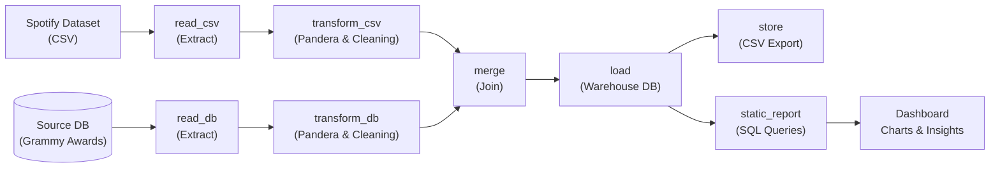
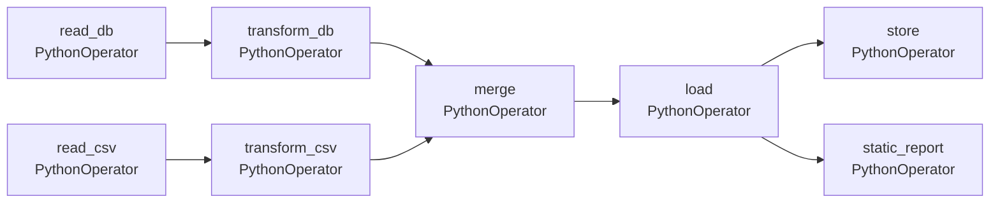
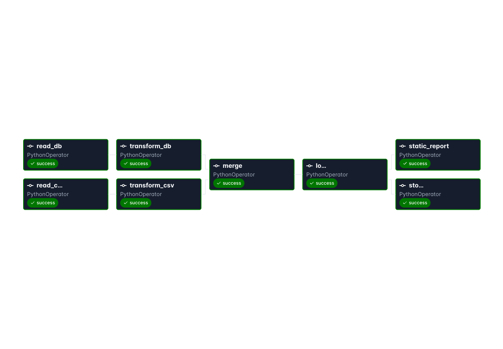

# Workshop-2: Automatización de la canalización ETL

**Curso:** ETL (G01)  
**Programa académico:** Ingeniería de Datos e Inteligencia Artificial  
**Facultad:** Ingeniería y Ciencias Básicas  
**Tecnologías:** Python, Apache Airflow, Pandera, SQLite, Pandas, Matplotlib, Seaborn, Jupyter Notebook

---

## 1. Resumen ejecutivo

Este proyecto implementa una canalización ETL completa que integra dos fuentes de datos heterogéneas:
1. **Spotify Tracks** (CSV)  
2. **Grammy Awards** (base de datos SQLite).  
Se valida la calidad de los datos con **Pandera**, se transforman y fusionan los conjuntos, se cargan en un **Data Warehouse** SQLite y se exporta el resultado a CSV.  
Un **dashboard estático** se genera exclusivamente a partir del almacén de datos.

---

## 2. Arquitectura y diagramas

### Diagrama de flujo de la canalización


### DAG de Airflow


---

## 3. Estructura del repositorio

```text
Workshop02/
├── README.md                         # Documentación del proyecto
├── requirements.txt                  # Dependencias de Python
├── run_pipeline.py                   # Ejecutable de línea de comandos
├── dags/
│   └── spotify_grammys_etl_dag.py    # DAG de producción para Airflow
├── etl/
│   ├── __init__.py
│   ├── config.py                     # Rutas y URIs de bases de datos
│   ├── validation.py                 # Esquemas Pandera
│   ├── extract.py                    # Lectura de CSV y DB
│   ├── transform.py                  # Limpieza, ingeniería y merge
│   ├── load.py                       # Carga a DW y exportación CSV
│   └── report.py                     # Generación de dashboard estático
├── db/
│   ├── init_db.py                    # Poblado inicial de la base source
│   ├── source_database.db            # Base de datos con Grammy Awards
│   └── warehouse.db                  # Data Warehouse con datos fusionados
├── data/
│   ├── raw/
│   │   ├── spotify_dataset.csv       # Dataset CSV de Spotify
│   │   └── grammy_awards.csv         # Dataset CSV de Grammy Awards
│   └── processed/
│       └── merged_spotify_grammys.csv # Resultado final del ETL
├── reports/
│   ├── static_dashboard_report.md    # Reporte markdown con hallazgos
│   ├── spotify_grammys_etl_dag-graph.png # **Evidencia del DAG ejecutado**
│   └── figures/
│       ├── 01_popularity_by_award_status.png
│       ├── 02_audio_features_comparison.png
│       ├── 03_top_grammy_artists.png
│       └── 04_top_genres_grammy.png
```

---

## 4. Descripciones de los conjuntos de datos

### 4.1 Spotify Tracks (CSV)
- **Origen:** Kaggle – *Spotify Tracks Dataset*
- **Volumen:** 114 000 registros
- **Campos clave:** `track_id`, `artists`, `album_name`, `track_name`, `popularity`, `duration_ms`, `danceability`, `energy`, `tempo`, `track_genre`, entre otros.

### 4.2 Grammy Awards (SQLite)
- **Origen:** Kaggle – *Grammy Awards Dataset*
- **Volumen:** 4 810 registros
- **Campos clave:** `year`, `title`, `category`, `nominee`, `artist`, `workers`, `winner`.
- **Carga inicial:** `db/init_db.py` inserta el CSV en `source_database.db`.

---

## 5. Implementación detallada de la canalización

### 5.1 Extracción (`etl/extract.py`)
- `read_csv` lee `data/raw/spotify_dataset.csv` con Pandas.
- `read_db` consulta `grammy_awards_raw` desde `db/source_database.db` usando SQLAlchemy.

### 5.2 Validación de calidad (`etl/validation.py`)
- Se define `SpotifyRawSchema` y `GrammyRawSchema` con Pandera.
- La validación captura anomalías (p.ej., filas con `duration_ms <= 0`).

### 5.3 Transformación (`etl/transform.py`)
- Normalización de textos, eliminación de duplicados, creación de variables derivadas.
- Recuperación de artistas faltantes en Grammy mediante regex sobre la columna `workers`.
- Fusión de datasets mediante join compuesto `(artist_norm, track_norm)` y `artist_norm`.

### 5.4 Carga y exportación (`etl/load.py`)
- Inserción del conjunto fusionado en `db/warehouse.db` (tabla `merged_spotify_grammys`).
- Exportación a `data/processed/merged_spotify_grammys.csv`.

### 5.5 Reporte estático (`etl/report.py`)
- Consultas SQL sobre el DW para obtener métricas clave.
- Generación de cuatro visualizaciones guardadas en `reports/figures/`.
- Redacción de `reports/static_dashboard_report.md` con hallazgos.

---

## 6. Dashboard estático y hallazgos

| Métrica | Ganador de pista | Artista ganador | No ganador |
|---|---:|---:|---:|
| **Cuenta de pistas** | 282 | 6 778 | 82 680 |
| **Popularidad media** | **47,38** | **32,03** | 33,25 |
| **Danceability media** | **0,590** | 0,539 | 0,564 |
| **Energy media** | **0,636** | 0,542 | 0,642 |
| **Acousticness media** | 0,261 | **0,415** | 0,321 |
| **Valence media** | **0,542** | 0,499 | 0,467 |
| **Duración media (min)** | 4,08 | 3,68 | 3,83 |

> Las visualizaciones se encuentran en `reports/figures/` y se incluyen en el reporte markdown.

---

## 7. Cómo reproducir la solución

### Prerrequisitos
- Python 3.10+ (se probó con 3.12 y 3.13)
- Entorno virtual (`venv` o `conda`)

### Pasos
```bash
# Clonar el repositorio y crear entorno
git clone <repo-url>
cd Workshop02
python3 -m venv .venv
source .venv/bin/activate
pip install --upgrade pip
pip install -r requirements.txt

# Inicializar la base de datos de origen
python -m db.init_db

# Ejecutar la canalización completa en una sola orden
python run_pipeline.py
```

### Ejecutar con Apache Airflow
```bash
export AIRFLOW_HOME=$(pwd)
airflow standalone
```
1. Abra la UI en `http://localhost:8080`.
2. **Credenciales predeterminadas:**
   - Usuario: `admin`
   - Contraseña: `admin`  
   (definidas en `airflow.cfg` y `simple_auth_manager_passwords.json.generated`).
3. Active y dispare el DAG `spotify_grammys_etl_dag`.
4. Verifique que todas las tareas terminen en verde.

### Evidencia del DAG ejecutado


---

## 8. Referencias
- [Kaggle – Spotify Tracks Dataset](https://www.kaggle.com/datasets/maharshipandya/-spotify-tracks-dataset)
- [Kaggle – Grammy Awards Dataset](https://www.kaggle.com/datasets/unanimad/grammy-awards)
- Documentación de Apache Airflow, Pandera y SQLAlchemy.
