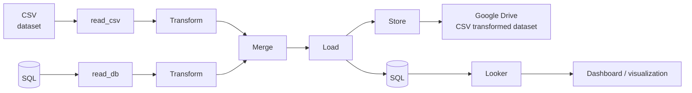
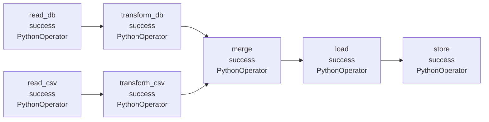

# FACULTY OF ENGINEERING AND BASIC SCIENCES

## ACADEMIC PROGRAM: DATA ENGINEERING AND ARTIFICIAL INTELLIGENCE

**COURSE:** ETL (G01)

# Workshop-2: Automatization of ETL pipeline

## Introduction

This workshop is an exercise on how to build an ETL pipeline using Apache Airflow, the idea is to extract information using different data sources (csv file, database), then do some transformations and merge the transformed data to finally load into google drive as a CSV file and store the data in a DB. As a last step, create a dashboard from the data stored in the DB to visualize the information in the best way you consider.

### A few things to consider:

1. I ask that you complete this challenge within the timeframe agreed on our conversation (look up in the platform).
2. I highly recommend not using tools such as Copilot, chatGPT, Claude, or similar to simplify or generate code to support the challenge. Doing this will be grounds for automatic disqualification.

## Getting started

In this challenge, you will receive some data, and your final objective is to show me all the ETL process using two data sources and some chart visualizations.

In this workshop we will use the spotify dataset (link in the data section) to be readed in python and airflow, therefore, you will apply a basic data quality validation (I recommend to use Pandera, or python implementation). Then, create some transformation and load into a database, on the other hand we will use the grammys dataset to be loaded into a database, then using airflow we will read the data from the database, perform some transformations, merge with the spotify dataset and load into the database.

## What is expected

I expect that you get the CSV file and the database created, and create an ETL data pipeline to extract the information, basic data quality validation, transform, merge, and store (in a DB and in google drive -or local- as a CSV file). Also, you will display those data from the database in chart visualizations; remember, the data should be stored in a database, and your reports must come from the database, not the CSV file.

In summary, your goal is to:

1. Design an orchestation pipeline.
2. Implement basic data quality validation of extraction phase.
3. Merge the two data sources in order to create an static report/dashboard directly from the database.

## Diagram

The following figure shows a diagram of the project:

### Project diagram

## Airflow visualization

The next figure is a possible visualization of how the project may looks like in apache airflow:

### Airflow DAG

## Technologies

We expect you to use in this challenge:

- Python
- Jupyter Notebook
- Database (you choose)
- Apache airflow
- Pandera
- CSV files
- Static report (is not mandatory use of Looker, Superset or similar)

## Task breakdown

### 1. ETL pipeline design & orchestration

a. Design the complete ETL pipeline using Apache Airflow.

b. Define the necessary tasks/operators and their dependencies.

c. The pipeline should include, at minimum:

i. Read Spotify dataset from CSV.  
ii. Read Grammys dataset from the database.  
iii. Data quality validation.  
iv. Merge the transformed datasets.  
v. Load the final dataset into the database.  
vi. Store the transformed dataset as a CSV file in Google Drive or in local.

d. Provide a diagram of the pipeline and a brief explanation of the workflow.

### 2. Data quality validation

a. Implement basic data quality validation for at least one of the dataset during the extraction/processing phase.

b. You may use Pandera or a Python-based implementation.

c. Define and apply appropriate validation rules, such as:

i. Data types.  
ii. Missing values.  
iii. Basic value/domain constraints where applicable.

d. The pipeline should make it possible to identify whether the data passes or fails the defined validations.

### 3. Transformation and load

a. Define the logic used to merge the two datasets.

b. Execute the merge as part of the Airflow pipeline.

c. Load the final merged dataset into a database.

d. Export the merged dataset as a CSV file stored in google drive or local.

### 4. Static report

a. Build a static report/dashboard using the data stored in the database.

b. The report must use the database as its source, not the original CSV file.

c. The use of Looker, Superset, or a similar visualization tool is optional.

### 5. Deliverables

The workshop may be submitted in either of the following formats:

#### a. Google Colab

i. A .ipynb notebook containing the implementation and evidence of the process.

ii. Documentation included in the notebook.

#### b. GitHub repository

i. Organized repository containing the Airflow pipeline and supporting code.

ii. README.md with project documentation.

iii. Supporting configuration required to reproduce the solution.

## Evaluation criteria

| Item | Description | Weight |
|---|---|---:|
| Etl pipeline design & orchestration | Complete ETL pipeline implemented using Apache Airflow; appropriate tasks/operators and dependencies; correct execution flow from extraction through storage. | 1.3 |
| Data quality validation | Basic data quality validation implemented for at least one dataset, using Pandera or Python; appropriate validation rules; pipeline clearly identifies whether data passes or fails validation. | 1.0 |
| Transformation & load | Correct merge logic; merge executed within the Airflow pipeline; final merged dataset correctly loaded into the database and exported as CSV to Google Drive or local storage. | 1.0 |
| Static report & visualizations | Static report/dashboard created from data stored in the database. | 0.5 |
| Submission & code quality | Submission provided as a functional Google Colab notebook or an organized GitHub repository; implementation and supporting files are appropriately structured and understandable. | 0.5 |
| Technical documentation | Clear documentation of the pipeline, workflow, implementation, validation, transformations, merge logic, execution and relevant decisions. | 0.7 |

## Data

You may download each dataset as CSV file or via mlcroissant.

1. Dataset to be readed as CSV: Spotify dataset
2. Dataset to be loaded into the initial database: Grammys Dataset

**Note:** The original information about the datasets can be found in:

- https://www.kaggle.com/datasets/maharshipandya/-spotify-tracks-dataset
- https://www.kaggle.com/datasets/unanimad/grammy-awards
